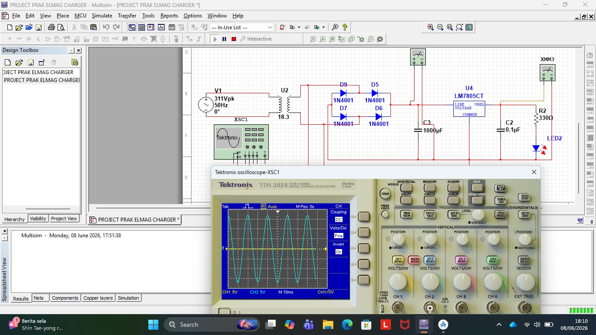
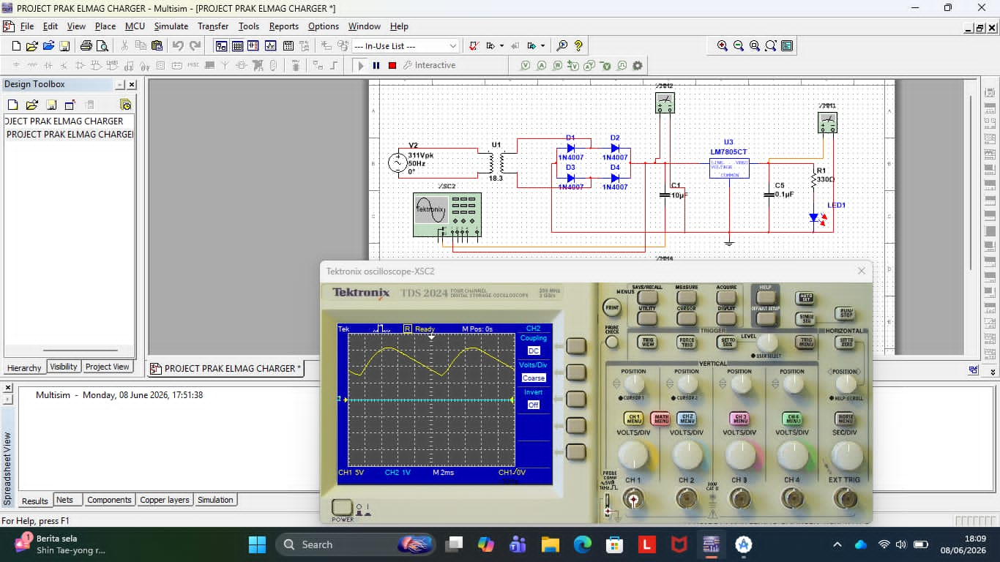

# Adaptor-Charger-Power-Supply-
Perancangan dan pengujian sirkuit penyearah daya gelombang AC ke DC teregulasi menggunakan software NI Multisim untuk menjamin kestabilan suplai tegangan perangkat elektronika.  Problem:

# Desain dan Simulasi Rangkaian Power Supply Adaptor Charger 5V Teregulasi
*(Proyek Praktikum Elektromagnetika - Politeknik Elektronika Negeri Surabaya)*

## 📝 Deskripsi Proyek
Proyek ini melakukan perancangan, pemodelan, dan analisis karakteristik sirkuit catu daya (power supply) charger dari sumber tegangan AC jala-jala listrik menuju output tegangan DC 5V stabil menggunakan perangkat lunak NI Multisim. Proyek ini membandingkan pengaruh nilai kapasitansi filter terhadap faktor riak (*ripple factor*) pada gelombang keluaran.

## 📐 Spesifikasi Parameter Desain & Komponen
- **Tegangan Input:** AC \(311\text{ Vpk}\) (\(220\text{ Vrms}\)), \(50\text{ Hz}\) melalui Transformator Step-Down (Rasio Tegangan Sekunder 18.3).
- **Blok Penyearah:** Konfigurasi Full-Wave Rectifier menggunakan 4x Dioda **1N4001**.
- **Blok Regulator:** IC Regulator **LM7805CT** untuk mengunci output tegangan konstan pada level **5 VDC**.
- **Beban Keluaran:** Resistor \(330\ \Omega\) dilengkapi dengan indikator visual LED.
- **File Mentah Simulasi:** Tersedia di repositori ini (`PROJECT PRAK ELMAG CHARGER.ms14` file) untuk pengujian sirkuit interaktif langsung.

## 📊 Analisis Karakteristik Perubahan Sinyal

Simulasi dilakukan untuk memverifikasi transisi perubahan gelombang dari arus bolak-balik (AC) menjadi arus searah (DC) yang stabil:

1. **Tahap Setelah Trafo & Sebelum Dioda Bridge (Arus AC murni):**
   Sinyal yang terukur pada osiloskop menunjukkan gelombang sinusoidal murni sempurna. Hal ini membuktikan bahwa transformator berfungsi menurunkan level tegangan, tetapi sifat arus listriknya masih berupa AC (Arus Bolak-Balik).
   

2. **Tahap Setelah Dioda Bridge & Variasi Kapasitor Filter (Transmutasi ke DC):**
   - **Kondisi Kapasitor Kecil (10 µF):** Tegangan telah berubah menjadi searah (DC), namun memiliki faktor riak (*ripple factor*) yang sangat besar (berbentuk riak gigi gergaji yang tajam pada osiloskop).
   - **Kondisi Kapasitor Besar (1000 µF):** Saat nilai kapasitansi dinaikkan hingga 1000 µF, filter mampu menyimpan dan membuang muatan secara stabil, mereduksi riak (*ripple*) menjadi sangat kecil hingga menghasilkan garis DC rata yang ideal sebelum masuk ke IC Regulator LM7805.
   
